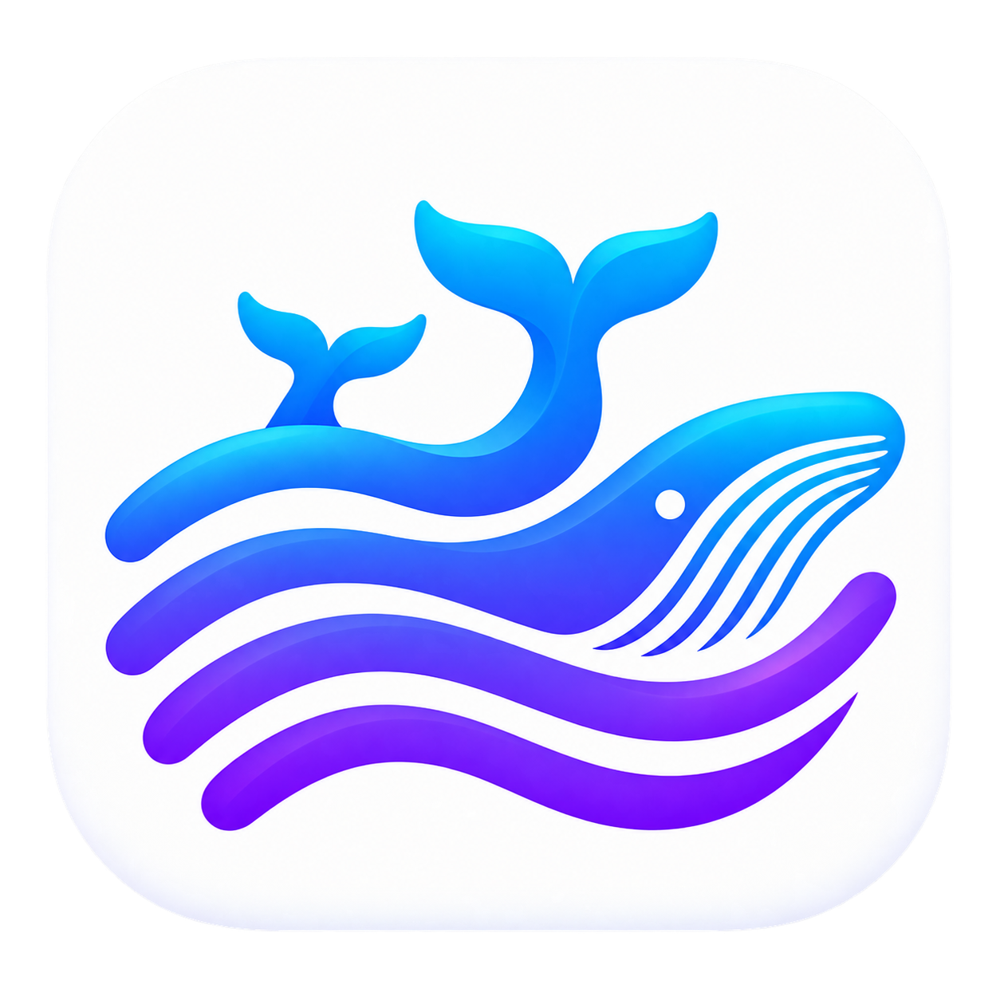

<p align="center">
  
</p>

<h1 align="center">Corum Harness</h1>

<p align="center">
  基于 <a href="https://github.com/deepseek-ai/deepseek-harness">DeepSeek Harness</a> 底座构建的
  <b>通用 Agent 软件</b>——把 agent loop、工具系统、多 Agent 编排、记忆、技能打包成开箱即用的产品，
  面向编程场景与通用 Agent 场景。
</p>

<p align="center">
  
  
  
  
</p>

<p align="center">
  <b>📣 进交流群</b>：微信扫码加入「Corum 交流群」，反馈问题、共建工作流<br>
  
  <br>个人微信：<b>hjkkclife</b>（备注 corum，欢迎交流共建）
</p>

---

## 这是什么

Corum Harness 把 DeepSeek Harness 从一个 **Agent 运行时**，扩展成一个**可直接使用的 Agent 产品**：
dsh 运行时内核 + Electron 桌面承载层 + 38 个自研插件 + 一套默认配置。

> **定位类比**：DeepSeek Harness 是「Linux 内核」（Cordis 插件框架 + agent loop + capability seam），
> 本项目是「发行版」（产品化的 Agent 能力 + 插件 + 默认配置）。**不改内核，只做用户空间。**

底座能力（context 管理、工具系统、LLM 适配、会话存储、subagent 机制）全部继承自 dsh；
本项目的价值集中在**把 Agent 能力做成可直接使用的产品**——编程助手是最先落地的场景。

---

## 核心能力

- **多 Agent 编排**：`orchestrate` 声明式 fan-out；子 Agent 在独立 git worktree 中工作并自动集成；
  子 Agent 卡片可见可控，编排进度一目了然。
- **指挥模式（Conductor Mode）**：「一个技术负责人带一支队伍」的基础模式
  （`baseMode: 'conductor'`，与 `standard` / `ptc` / `minimal` / `cordis` 并列）：
  - 指挥者是技术负责人，不是调度员——判断问题是什么、该怎么解、结果是否真的达标；
  - 恒只读：不给写工具、只给只读 shell，约束走机制层门禁，用户权限档位只对 worker 生效；
  - 三阶段调研：入门自己看（有界）→ 深入交给 research 子 Agent → 收尾只做点读验收；
  - 子 Agent 的报告是**主张**不是证据，验收必须亲自看 diff。
- **Agent 预设（persona）**：岗位、人格、职责、域边界、模型路由（主 / 子 / 调查三档独立配置）。
- **记忆底座**：事实级存储、存续期与衰减，设置中心可配。
- **MCP 集成**：MCP 服务管理与授权，工具自动装配进 Agent。
- **技能库**：可绑定的可复用技能（含项目自带开发规范技能）。
- **本地模型**：支持 Ollama 等本地 provider，云端 / 本地随配置切换。
- **文生图**：本地文生图能力（`corum-artgen`）。
- **编程工作台**（编程场景的落地形态）：Monaco 编辑器 + 文件树 + 终端 + 对话区，可拖拽重组。

### 工程化

- **插件化发行**：38 个插件包按 `ui` / `session` / `agent` 分组，能力与界面同包。
- **最小内核侵入**：官方包尽量从 npm registry 原样引用；必要的定制集中在 **16 个 fork 包**
  （修补底座在上层暴露的能力缺口），差异全部登记在 [`docs/fork-delta.md`](docs/fork-delta.md)
  并由 `scripts/verify-fork-drift.sh` 守卫字节级一致性——其余定制仍通过「写插件 + overlay 覆盖行」完成。
- **可验证性优先**：CDP 实机验证技能 + 声明式断言跑器，界面改动必须跑真机三层验证
  （渲染 / 行为 / 零控制台错误）。

---

## 快速开始

**环境要求**：Node `^22.19.0 || >=24.0.0`，pnpm `11.7.0`。

```sh
pnpm install
pnpm shell:dev        # 开发态启动桌面应用
pnpm pack             # 打包 macOS 应用（.app / .dmg）
```

> **平台说明**：当前打包链路面向 **macOS（Apple Silicon）**；跨平台（Windows / Linux）尚在规划中。

### 构建与检查

```sh
pnpm build          # 全量构建（packages/**）
pnpm typecheck      # 全量类型检查
pnpm shell:smoke    # 冒烟启动

# fork 与官方基线的漂移守卫（改 fork 包后必跑）
./scripts/verify-fork-drift.sh
```

---

## 仓库结构

```
packages/
├── desktop/                  # Electron 桌面承载层（壳 + 宿主桥 + 打包）
│   ├── src/host/              #   host 侧：桥接、IPC、打包闭包
│   ├── src/client/            #   renderer 侧：壳、编辑器、布局
│   └── assets/                #   品牌与图标资源
└── plugins/                  # 38 个插件包，按能力分组
    ├── ui/        (12)        #   界面区域：面板、插件中心、主题基座
    ├── session/   (11)        #   会话与交互：对话、审批、提问、模型选择
    └── agent/     (15)        #   Agent 能力：编排、子 Agent、记忆、MCP、工具

profile/corum/                # 发行版 profile 清单
cordis.patch.yml              # 发行版 overlay（覆盖官方默认行 + 插入插件行）
docs/                         # fork 差异台账与开源资产
scripts/                      # 开发 / 验证 / 打包 / 审计脚本
skills/                       # 项目自带技能（开发规范、CDP 实机验证）
```

**插件是怎么被加载的**：每个插件包自带 `cordis.patch.yml` 声明挂载行，发行版
`cordis.patch.yml` 只放跨包覆盖；新增插件须同时登记进 `packages/desktop/package.json`
与 `packages/desktop/desktop-host/package.json`（打包闭包按后者补齐，遗漏会导致
**仅打包态**功能缺失）。

---

## 启动主题

桌面端在“设置 → 外观 → 启动”中管理启动主题，支持导入 ZIP、预览、切换和删除。主题可使用 HTML 动画或本地视频，播放结束且主界面就绪后进入，也可按 Esc 跳过。

主题包格式、HTML 示例、视频模板与打包工具见 [启动主题制作说明](packages/desktop/startup-theme-kit/README.md)。仓库提供内置 HTML 终端动画和源文件模板，视频素材由主题作者自行放入包内。

## 插件开发

Corum 支持不修改宿主源码的第三方插件：一个包可同时包含 **host 宿主半**与可选的
**client 客户端半**，提供 Cordis 服务、注册 Agent 工具、读取会话信息，或扩展指定 UI 区域。
插件使用 `dsh.bundle` 形态分发，由自带的 `cordis.patch.yml` 完成挂载。

- **完整开发指南**：[插件开发指南](packages/sdk/corum-plugin-sdk/GUIDE.md)（能力 API、安装、调试与故障排查）
- **最小示例**：[hello-plugin](examples/hello-plugin/README.md)
- **完整示例**：[region-replacement-plugin](examples/region-replacement-plugin/README.md)（UI 区域覆盖、设置页、工具注入与会话信息）

### 从脚手架开始

在独立目录中创建插件；`@you/my-plugin` 换成自己的包名，`my-plugin` 换成目标目录：

```sh
npx --yes --package @corum/plugin-sdk corum-plugin-init \
  --name @you/my-plugin --dir my-plugin
cd my-plugin
pnpm install
pnpm build
```

脚手架默认生成同时包含 host 与 client 的 K2 插件；只开发宿主能力时可加 `--kind k1`。
SDK、构建配置、挂载声明和兼容字段会一并生成，无需手写 bundle 闭包。
若镜像源尚未同步 `@corum` 包，请在项目的 `.npmrc` 中配置：

```ini
@corum:registry=https://registry.npmjs.org/
```

### 一个最小宿主插件

```ts
import { definePlugin, type Context } from '@corum/plugin-sdk'

export const name = 'hello-plugin'
export const inject: string[] = []

export function apply(ctx: Context): void {
  ctx.provide('helloPlugin', {
    greet: (who: string) => `hello, ${who}`,
  })
}

export default definePlugin({ name, inject, apply })
```

宿主半导出 `name`、依赖声明 `inject` 和装配函数 `apply`；副作用放进 `apply`，
不要放在模块顶层。客户端半可以注册 `corum.editor`、`corum.trajectory`、`corum.panel`
三个区域的覆盖组件，或添加「设置 → 扩展」页面；布局与内部槽位仍由宿主管理。

### 构建、安装与验证

UI 插件必须完整执行三步构建，脚手架已配置好，**不要只运行 `tsdown`**：

```sh
pnpm build       # tsc -b && tsdown && corum-inline-css
pnpm typecheck
pnpm test        # 若已添加测试
```

将插件安装到当前 Corum profile，然后重启应用使宿主半生效：

```sh
cd ~/.corum/profiles/web
pnpm add @you/my-plugin
```

开发者也可在「设置 → 高级」开启开发者模式，通过「集成中心 → 扩展包 → 导入本地扩展包」
导入目录或 ZIP。启动失败的插件会显示具体原因，并可从已装列表移除。

提交前至少通过类型检查、测试和构建；本仓插件还需运行：

```sh
pnpm verify:plugin-spec
pnpm verify:plugin-ui
pnpm verify:plugin-guide
```

### 开发红线

1. **跨 bundle 共享状态一律用 Cordis 服务**，不要挂 window 全局或模块级单例
   （bundle 各自内联 `@corum/*` 源码，模块级状态会被复制成多份且永不收敛）。
   服务通过 `inject` 声明后消费，不要对未装配的服务直接调用 `ctx.get`。
2. **不要随意 external 化 `@corum/*`**：底座的共享模块表有硬编码种子，
   自建共享模块走 `dsh.client` 路径会导致白屏——用 Cordis 服务绕开。
3. **依赖分层不能混**：`@corum/plugin-sdk` 放 `dependencies`；`@deepseek-ai/*` 和
   `react` 放 `peerDependencies`，并镜像到 `devDependencies`，避免加载两份基座实例。
4. **host 插件改动必须重启应用**（renderer 改动才走 HMR）；跨包状态 / 壳 / 调度器
   改动必须过 **CDP 实机三层验证**（UI 渲染 + 行为 + 零控制台错误）。
   **「编译通过」不等于「做完了」。**
5. **本仓内置插件**使用 `pnpm create:plugin --name @you/my-plugin --dir packages/plugins/<组>/my-plugin`
   生成，并登记到 `packages/desktop/package.json` 与 `packages/desktop/desktop-host/package.json`；
   修改 fork 包前先读 [fork 差异台账](docs/fork-delta.md)。第三方 `dsh.bundle` 插件不需要这些登记。

---

## 与 DeepSeek Harness 的关系

| | DeepSeek Harness | Corum Harness |
|---|---|---|
| 角色 | Agent 运行时内核 | Agent 产品发行版 |
| 提供 | Cordis 框架、agent loop、工具系统、capability seam | Agent 能力产品化、38 个插件、默认配置 |
| 依赖方式 | — | 大部分从 npm registry 引用官方包（`@deepseek-ai/dsh-*`）；另维护 **16 个 fork 包**修补能力缺口 |

本项目维护 16 个 **fork 包**（用于修补底座在上层暴露的能力缺口），差异全部登记在
[`docs/fork-delta.md`](docs/fork-delta.md)，并有 `scripts/verify-fork-drift.sh` 守卫字节级一致性。

---

## 开源范围

本项目采用 **open core** 模式：

- **开源（本仓库）**：**任务模式（Task Mode）**——单任务泳道 + 指挥模式 + 完整的 Agent
  能力面（编排、子 Agent、记忆、MCP、技能、编程工作台）。
- **闭源（独立维护）**：**项目模式（Project Mode）**——项目制工作区、多 Agent 团队协作、
  需求 / 任务 / BUG 管理与项目级知识治理。**开源发行版只呈现任务模式**，不提供项目模式入口。

> **剥离已完成（2026-09-27）**：项目模式的实现**已迁出本仓库**，现位于独立闭源仓
> [Corum-Harness-Project](https://github.com/kukucaiCndy/Corum-Harness-Project)；
> **本仓库为纯任务模式的开源形态**（侧栏不再出现「项目」tab，无相关依赖与挂载行）。
> 若要构建含项目模式的闭源形态，需把闭源仓的插件（`@corum/corum-project` 等）经 cordis patch
> 挂载到本仓之上，具体步骤见该仓的 README。历史规划文档已不入库。

## 项目状态

**早期开发阶段**，接口与配置仍在快速演进，尚未发布稳定版本（当前 `0.1.0`）。
欢迎通过 Issue 反馈问题与建议。

## 许可证

[Apache License 2.0](LICENSE)。

选择 Apache-2.0 而非 MIT 的原因：它**显式授予专利许可**（第 3 节），对商业使用与
企业贡献者更友好，同时保留商标条款（第 6 节）。上游 DeepSeek Harness 为 MIT，
与本许可证兼容。

## 致谢

本项目构建于 [DeepSeek Harness](https://github.com/deepseek-ai/deepseek-harness) 与
[Cordis](https://github.com/deepseek-ai/cordis) 之上，感谢底座团队的工作。
