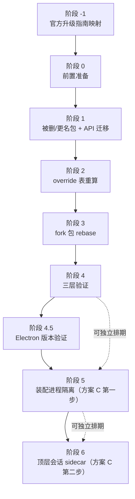

# dsh 基座 0.1.5-rc.3 → 0.2.1-rc.3 升级执行文档（索引册）

## 升级背景

**起因**：2026-10-26，用户在运行中的主实例上卸载 `corum-dev` 扩展包，热应用的 Loader 重 init
反注册了工具，导致运行中的子 agent 会话 `cf58d502` 命中 `ToolNotFoundError`，会话不可恢复。
根因是 corum 的单进程架构——所有插件、工具、子 agent 共享同一个进程，Loader 重建会级联破坏
活跃会话。用户倾向**方案 C（进程隔离）**修复该缺陷。

**目标**：
1. 将 dsh 基座从 `0.1.5-rc.3` 升级到 `0.2.1-rc.3`（跨 2 个 minor 版本，6026 commits）；
2. 落地方案 C 的第一步——子 agent 进程隔离（装配 `dsh-subagent-acp`，官方 0.2.1 已具备能力）；
3. 顶层会话 sidecar 进程隔离列为独立排期阶段（方案 C 第二步，corum 需自研）。

**本册**：升级执行文档的索引与总览，不包含执行步骤本身。各阶段执行手册见下方索引表。

> 单一事实源：`docs/UPGRADE-0.2.1-rc3-feasibility.md`（已含 2026-10-27 评审修订）。
> 评审证据报告（原三份，后续所有阶段的基础证据）：`~/.corum/research-reports/885858d9-…`（被删包引用点/50 fork 台账核查）、`5c35a73b-…`（invariants 方案 A 证据链）、`06867ebb-….md`（进程隔离/升级路径/数量级/override/acp）。
> 阶段 -1 新增三份（只用于阶段 -1 相关输入/评审记录）：`e9de057a-…`（指南清单/目录/文本量）、`abf2af7e-…`（corum 触点/指南内容）、`958879cc-….md`（可执行性/门禁/实录）。
> 实录文件：`docs/UPGRADE-0.2.1-rc3.md`（阶段 0 创建骨架；阶段 -1 实录暂记 01 册附录 B，阶段 0 建骨架时转录）。

> **当前进度**：阶段 -1 ✅ 已完成（2026-10-27）；阶段 0 ✅ 已完成（2026-10-27，备份+fork-drift N=3+基线快照+实录骨架）；**阶段 1 ✅ 已完成（2026-10-27，①~⑧+附 全部完成，9 个 commit，install 解析成功，静态门禁全过）**——9 个处置对象独立 commit（`fb4cb9fe`~`33dc7b19`），静态断链矩阵全清，`CI=true pnpm install --no-frozen-lockfile` 0 ERR_PNPM error，lockfile 已恢复，pnpm-workspace.yaml 未改；**阶段 2 ✅ 已完成（2026-10-27，S0-S4 全部完成，4 个 commit：`dbc3ed37`+`e26fc8fc`+`936ced5c`+`3c5db12e`，A1-A10 全绿，lock 幂等，skip-app 闭包审计全过）**——lock 重生成（0 ERR_PNPM，peer 无 issue，幂等 hash 一致），vendor 物化（cordis 4.0.5/cosmokit 1.8.6/schemastery 3.18.5/dsh-hmr 0.2.1-rc.3），闭包审计（258 dsh 包 uniform + 8 黑名单零命中 + 7 vendor 唯一 + 311 解析探针成功 + 7 平台专属包 OK）；**下一入口**：阶段 3（`05-fork-rebase.md`，50 个 fork 包逐个对照官方 0.2.1 重新合并）。

---

## 阶段依赖图

**关键说明**：
- 阶段 -1 是一切的前置——先映射 43 篇官方升级指南，再进阶段 0。
- 阶段 4（三层验证）通过后，阶段 5/6 可在 4 之后独立排期，不阻塞基座升级本身的收口。
- 阶段 4.5（Electron 版本验证）插在 4 与 5 之间：验证 `node-addon-native-custom-loader` 在
  Electron 43.4.1 旧指纹下可加载，决定是否同步升 Electron。
- 阶段 5 装配 `dsh-subagent-acp` 作为第三 provider 选项（非全量切换）；阶段 6 顶层 sidecar 自研。

---

## 阶段文件索引

| # | 文件 | 阶段 | 一句话目标 | 准入门禁摘要 | 退出门禁摘要 | 状态 |
|---|---|---|---|---|---|---|
| 1 | `01-official-guide-mapping.md` | -1 | 通读官方 0.2.1 升级指南（7 目录共 43 篇），产出「指南 → corum 影响映射表」 | 无（一切的前置） | 有效映射条目 ≥43，每条影响落到阶段 1-6 之一或显式标注「corum 不受影响」 | ✅ 已完成（2026-10-27，43/43篇，HMR已裁决） |
| 2 | `02-preparation.md` | 0 | 备份 home + 工作区 commit + 基线 fork-drift 守卫确认零漂移 + 记录基线快照 + 创建实录骨架 | 阶段 -1 退出门禁通过 | 备份完成 + 工作区干净 + fork-drift 零漂移 + 基线快照已记录 + 实录文件已创建 | ✅ 已完成（2026-10-27，备份2.77GB+fork-drift N=3+基线快照+实录） |
| 3 | `03-removed-packages.md` | 1 | 解决 4 个被删/更名包 + session-title API 迁移 + HMR 形态核查（待阶段 -1 裁决） | 阶段 0 退出门禁通过 | 4 个被删包全部改完 + invariants 方案 A 落地 + session-title API 迁移完成 + HMR 形态经阶段 -1 裁决后处置 + `pnpm install` 无断链 | ✅ 已完成（2026-10-27，①~⑧+附 9 commit，静态门禁全过，install 解析成功） |
| 4 | `04-overrides-lockfile.md` | 2 | S0 回补两包尾债 + override 脚本化生成 + fork manifest/desktop-host 同批升版 + 豁免整段删除 + vendor 重算 + lock 重生成 + `--skip-app` 部署闭包审计 | 阶段 1 退出门禁通过 + S0 回补 | override 全量 rc3 + lock 重生成幂等 + `--skip-app` 部署断言全绿 + 解析探针全过 | ✅ 已完成（2026-10-27，S0-S4 全过，A1-A10 全绿，4 commit） |
| 5 | `05-fork-rebase.md` | 3 | 50 个 fork 包逐个对照官方 0.2.1 重新合并 | 阶段 2 退出门禁通过 | 50 个 fork 包全部 rebase 完成 + corum-subagent 大头单独收口 + fork-drift 方向收敛 | ☐ 待开工 |
| 6 | `06-verification.md` | 4 | 三层验证：tsc --force 0 错 + 全测试绿 + fork-drift 过 + 实机 CDP 冲烟 + V3→V4 迁移预演 | 阶段 3 退出门禁通过 | 三道总门禁全绿 + 三平台实机冲烟 + 存量会话 V3→V4 预演通过 | ☐ 待开工 |
| 7 | `07-acp-subagent-isolation.md` | 5 | 装配 `dsh-subagent-acp` 作为第三 provider 选项 + 子进程命令/模型/权限产品决策 | 阶段 4.5 通过 | acp provider 可挂载 + 子 agent 进程隔离修复卸载破坏活会话路径 + corum 隔离体系与 acp 并存 | ☐ 待开工 |
| 8 | `08-top-level-sidecar.md` | 6 | 自研顶层会话进程隔离 sidecar（复用 subprocess seam + SessionWriteLease + acp 协议） | 阶段 5 退出门禁通过（可独立排期） | 顶层会话进程隔离可用 + 卸载插件不破坏顶层活会话 | ☐ 待开工 |

> **注意**：阶段 4.5（Electron 版本验证）未单独成册，其内容并入 `06-verification.md` 的
> Electron 验证子节。索引表 8 个文件对应 8 个阶段（-1/0/1/2/3/4/5/6），阶段 4.5 是阶段 4
> 手册内的一个子节。

---

## 三道总门禁

升级全程的三道退出门禁，每道都必须通过方可宣告完成：

1. **全仓 `tsc -b --force` 0 错**
   - `tsc -b` 是增量编译，**必须加 `--force`**——不加会藏住破坏点（0.1.5 升级时实测：
     不加 `--force` 报 0 错，加了报 31 处错误）。
   - 命令：`pnpm -r run typecheck` 或等价的全仓 `tsc -b --force`。

2. **全仓测试绿**
   - 全量测试套件通过，0 失败。
   - 0.1.5 升级基线为 1932 通过 0 失败；本次预计因删 invariant spec 略降。

3. **fork-drift 守卫过 + 实机 CDP 冲烟**
   - `DSH_CHECKOUT=/Users/kukucai/dsh DSH_BASELINE_TAG=dsh-v0.2.1-rc.3 ./scripts/verify-fork-drift.sh` 通过。
   - 实机 CDP 冲烟：UI 渲染正常 + 行为正确 + **零 console 错误**（三平台覆盖：macOS/Linux/Windows）。
   - "它编译过" ≠ "它跑得起来"——0.1.5 升级时实机抓出 2 个编译期发现不了的真 bug。

---

## 工程量总表

| 维度 | 0.1.3 → 0.1.5（上次） | **0.1.5 → 0.2.1（本次）** |
|---|---|---|
| commit 数 | 约 200 | **6026** |
| 改动文件 | 约 300 | **12855** |
| 新增行 | 约 2 万 | **+161.5 万**（1615319 insertions / 214894 deletions） |
| 官方包总数 | — | **278 → 362**（+84） |
| override 基线 | 137 条 | **217 条 → 预计 250-300 条** |
| fork 包 | — | **50 个**（23 agent + 12 session + 15 ui） |
| 被删/更名包 | 0 | **4 个删除/重命名 + 1 个更名 + session-title API 迁移** |
| cordis 版本 | 无变化 | **4.0.2 → 4.0.5**（11 commits，patch 级） |
| 时间跨度 | — | **2026-09-22 → 2026-10-23**（一个月） |

> 数据来源：可行性文档 §一 + 评审报告 06867ebb §A（`git rev-list --count` /
> `git diff --shortstat` 原始命令输出验证）。override 基线 217 条由评审报告 06867ebb §E1
> 核实（`pnpm-workspace.yaml:43-306`，其中 `@deepseek-ai/dsh-*` 211 条 + 其余 6 条）。

---

## 关键纪律提示

执行全程必须遵守以下纪律（违反即返工）：

1. **`tsc -b` 必须加 `--force`**
   增量编译会藏住破坏点。0.1.5 升级时实测：不加 `--force` 报 0 错，加后报 31 处。
   每次 typecheck 都用 `tsc -b --force`，不要图快用增量。

2. **官方包可解析性必须直接验证**
   官方 npm 包有系统性打包缺陷（运行时依赖放进 `devDependencies`）。
   不要信扫描脚本的「全部可解析」结论——逐包 `pnpm install` + `require.resolve` 验证。
   0.1.5 升级时遇 2 处。

3. **`docs/` 需要 `git add -f`**
   `docs/` 目录整体被 `.gitignore` 忽略（仅 `docs/assets/`、`docs/fork-delta.md` 等少数文件豁免）。
   所有升级文档写入后必须 `git add -f docs/upgrade-0.2.1-rc3/` 强制入库。
   实录文件 `docs/UPGRADE-0.2.1-rc3.md` 同理需 `git add -f`。

4. **三平台覆盖原则**
   任何改动都要问：这在 darwin / linux / win32 上是否行为一致？
   隐式假设（硬编码 `/bin/zsh`、`~/.corum-desktop`、`/`-only path joins、macOS 像素 insets、
   POSIX-only 命令）不会在第三平台报错，而是**静默行为不同**。
   实机验证必须覆盖三平台（参考 `docs/dev-conventions.md` §16 / AGENTS 红线 7）。

5. **实录写 `docs/UPGRADE-0.2.1-rc3.md`**
   每个阶段执行时，逐步往实录文件记录（命令、输出、决策、偏差）。
   这是后续 0.2.x → 0.3.x 升级的参照。0.1.5 升级的实录（35 步）存于
   `docs/UPGRADE-0.1.5-rc3.md`。

6. **dsh 官方仓只读**
   `/Users/kukucai/dsh` 是只读对比源，严禁 checkout / 写操作。
   跨版本对比用 `git -C /Users/kukucai/dsh show dsh-v0.2.1-rc.3:<path>` 即可。

7. **主实例 :9222 不承载验证**
   升级期间的实机验证走 `--home=verify` 验证实例（`scripts/corum-instance.sh start --home=verify`），
   不要在用户正在使用的主实例上跑验证。

8. **cordis 服务是跨 bundle 共享状态的唯一合法载体**
   不要用 window 全局或 module-level singleton（AGENTS 红线 1）。
   不要随意 externalize `@corum/*`（AGENTS 红线 2）。

---

## 文档清单

| 文件 | 说明 |
|---|---|
| `README.md`（本册） | 索引与总览 |
| `01-official-guide-mapping.md` | 阶段 -1：官方升级指南映射 |
| `02-preparation.md` | 阶段 0：前置准备 |
| `03-removed-packages.md` | 阶段 1：被删/更名包处理 + API 迁移 |
| `04-overrides-lockfile.md` | 阶段 2：override 重算 + lockfile |
| `05-fork-rebase.md` | 阶段 3：fork 包 rebase |
| `06-verification.md` | 阶段 4 + 4.5：三层验证 + Electron 验证 |
| `07-acp-subagent-isolation.md` | 阶段 5：装配进程隔离 |
| `08-top-level-sidecar.md` | 阶段 6：顶层会话 sidecar |

> 全部 9 册已落盘（2026-10-27）：README + 01~08。每册统一九章模板（README 除外）。
