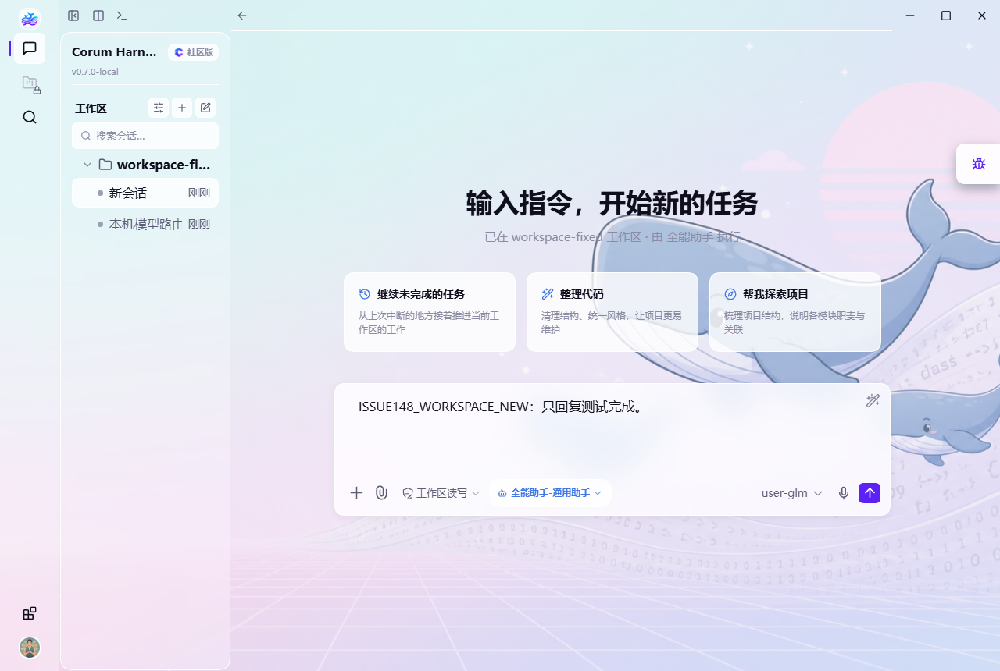
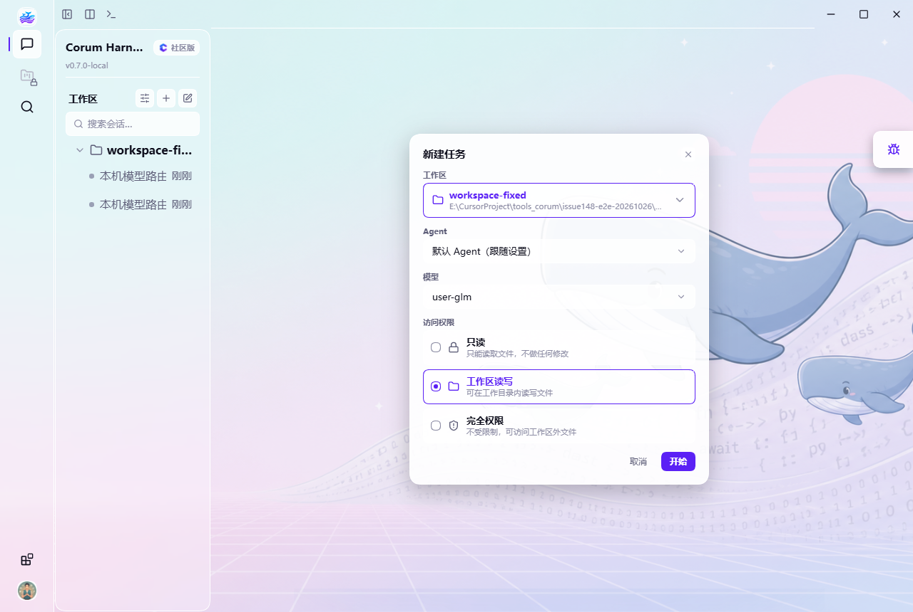
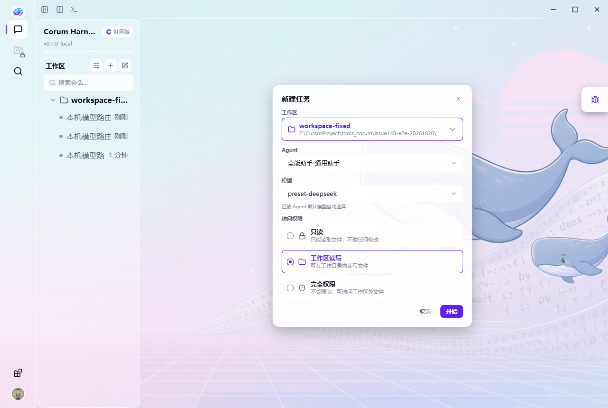
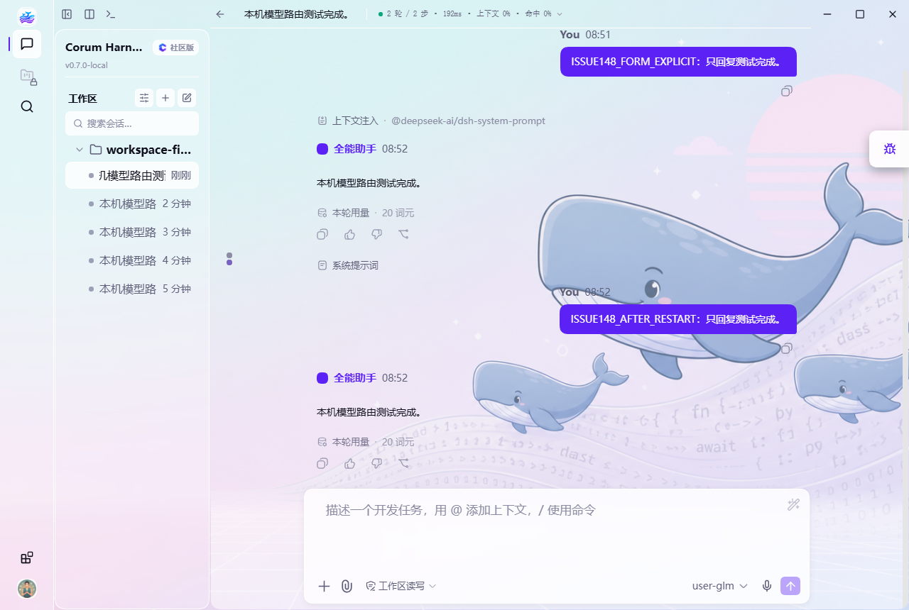

# #148 模型选择修复验证

## 问题与规则

原工作区“＋”入口省略 `profileId/model`，界面展示全局默认模型，但 Host 从默认 Agent 的预设读取模型。全局模型与 Agent 预设不同时，发送前的显示与实际 HTTP 请求不一致。

修复统一采用：**显式 model > 手选 Agent 的预设模型 > 未手选 Agent 时的全局默认模型**，包含 `provider/model/reasoningEffort`。新建向导保留工作区必选，并以“默认 Agent（跟随设置）”区分自动与手选。

## 自动化与构建

- 本轮定向运行：`task-model-routing.spec.ts` **8/8**，`new-task-form.spec.tsx` **7/7**，`vision-section-dedup.spec.ts` **6/6**；均 exit 0。
- 路由测试使用真实 Cordis 绑定、官方发布包 `modelSelection`/`turnBoundary` 投影及 `SessionController.inspect`；覆盖 blank 复用、旧 pending 覆盖、effort、连续请求和 cold resume。表单测试使用真实 React DOM。
- 复用前轮基线 Agent **422/422**、conversation **13/13**。前实现者记录修复后 Agent **430/430**、两个修改包 `tsc -b --force` 与构建通过；其最终日志未保留，不将该记录写成本轮重新运行的结果。conversation 完整 20 项未重复执行。
- 本轮按固定 BASE `6647d914` 对应的 Desktop 源码重新构建成功，避免其他分支的旧构建混入实际验证。实现 commit：`1a1115e7`。

## Windows 实际验证（2026-10-27）

使用真实 Electron 界面、独立 `CORUM_HOME` 和本机 OpenAI-compatible HTTP fixture。全局默认为 `issue148-fixture/user-glm`，全能助手预设为 `issue148-fixture/preset-deepseek`。名称用于制造两个不同路由；没有调用真实 GLM 或 DeepSeek 服务。

检查服务实际收到的 HTTP body `model`，而非模型回复中的身份描述；过滤自动标题请求，仅统计带测试标记的主对话。

| 场景 | 发送前界面模型 | 实际 HTTP model | 结果 |
| --- | --- | --- | --- |
| 显式 `createTaskAgent.model=user-glm` 对照 | `user-glm` | `user-glm` | 通过 |
| 工作区“＋”，未手选 Agent/model | `user-glm` | `user-glm` | 通过 |
| 新建向导，默认 Agent | `user-glm` | `user-glm` | 通过 |
| 新建向导，手选全能助手 | `preset-deepseek` | `preset-deepseek` | 通过；global 仍为 `user-glm` |
| 手选全能助手后显式选 `user-glm` | `user-glm` | `user-glm` | 通过 |
| 关闭应用前将 global 改为 `preset-deepseek`，冷重启原会话 | `user-glm` | `user-glm` | 通过；不回到 global/profile |
| 重启后同一会话继续下一轮 | `user-glm` | `user-glm` | 通过 |

连续两次点击工作区“＋”，空白会话均为 `corum-task-4bd6b937`，未生成第二个空白会话。重启测试会话为 `corum-task-f0ee9f48`，恢复的 `lastUsed/next` 均为 `user-glm`；截图可见重启前消息与重启后继续的消息。HTTP 请求同时包含此前历史和新消息。上述操作期间 CDP 采集结果没有 console error 或 exception。

### 实际请求摘录

以下为本机服务记录的主对话请求摘录，省略自动标题请求和请求其余内容：

```text
00:48:02Z ISSUE148_WORKSPACE_NEW       -> user-glm
00:48:46Z ISSUE148_FORM_DEFAULT        -> user-glm
00:49:53Z ISSUE148_FORM_MANUAL_AGENT   -> preset-deepseek
00:51:07Z ISSUE148_FORM_EXPLICIT       -> user-glm
00:52:26Z ISSUE148_AFTER_RESTART       -> user-glm
00:52:58Z ISSUE148_CONTINUED_TURN      -> user-glm
```

## 真实截图

工作区“＋”创建后，发送前使用全局模型：



未手选 Agent 时向导预览全局模型：



手选 Agent 后预览其预设模型：



冷重启后保留旧消息，并继续使用会话保存的模型：



## 验证范围与限制

- 独立 subagent 集中复审已通过：Spec compliance 与 Code quality 均通过，无阻塞；审核覆盖固定 BASE 至实现 commit 的全部差异、直接调用链、定向测试日志及实际 HTTP/重启截图证据。
- 实际验证覆盖 Windows 开发构建；未运行 macOS/Linux 实机或发行安装包验证。修改未增加平台分支、路径处理或原生 API。
- 本机 fixture 验证真实请求路由、流式回复与持久恢复；不验证 GLM/Kimi/DeepSeek 远端认证、服务可用性、特有参数或回答质量。无需真实 API key。
- 未重新运行全仓测试；复用已有基线与通过结果，只运行改动直接相关的回归。
- #149 的保存供应商后刷新模型列表问题不在本次修复范围；PR #153 保持独立。
