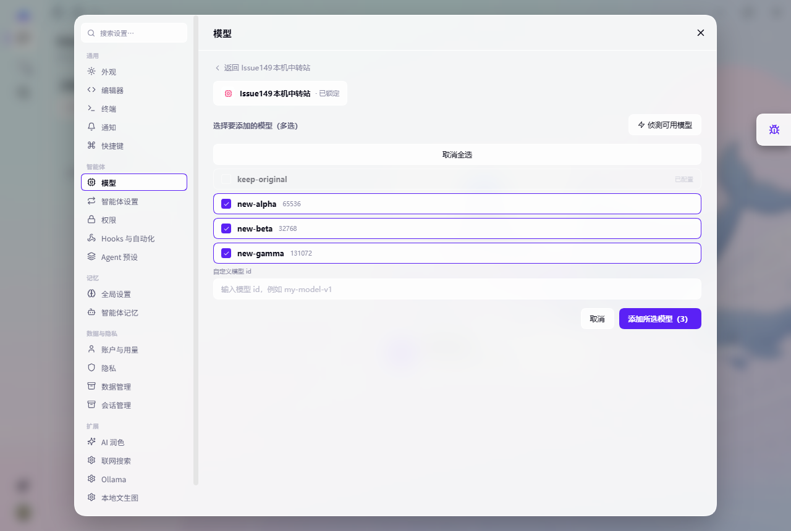
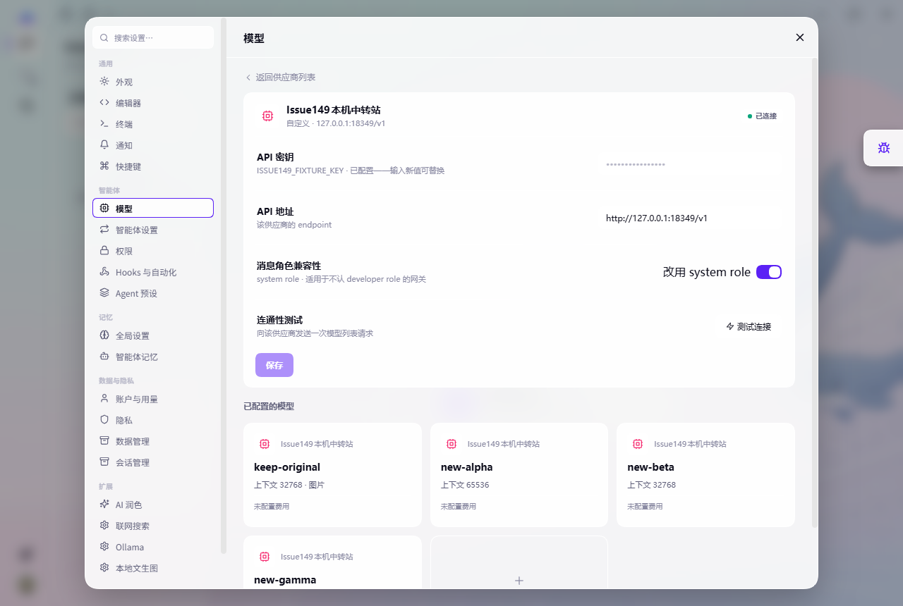
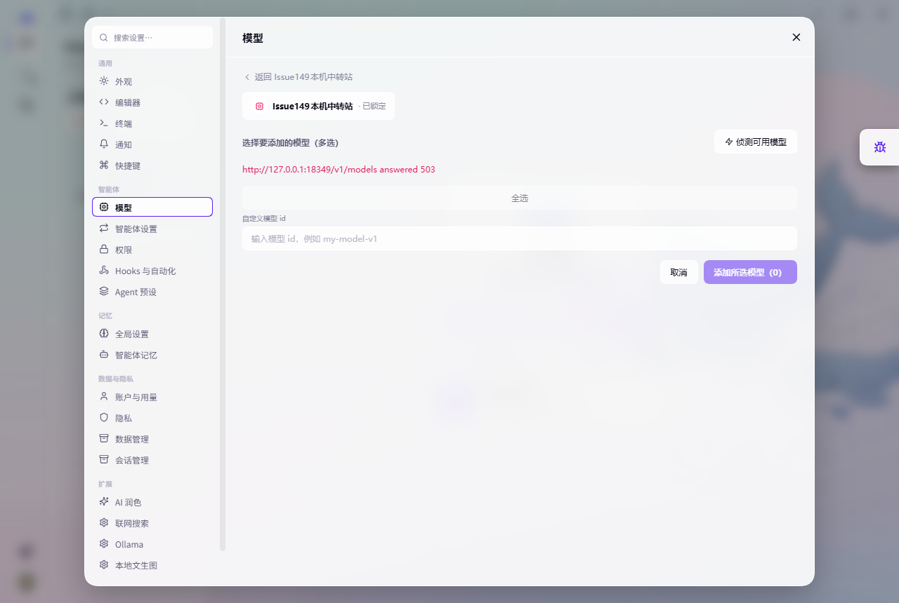
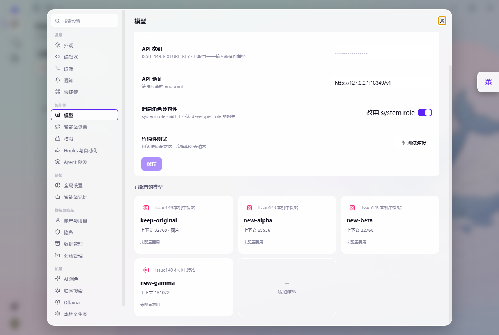

# #149 已保存供应商批量添加模型验证

## 问题与修复

首次配置供应商的向导已支持多选，但保存后“添加模型”走单选页面，每次只进入一个模型的配置。诊断组件验证确认“侦测可用模型”可以重复调用接口，缺少的是保存后的批量添加流程。

修复后沿用原入口：重新获取模型 → 多选或全选 → 一次添加。已有模型灰化禁选，自定义模型 ID 输入保留；添加后仍可进入各模型详情调整参数。只追加去重的新模型，保留供应商配置和已有模型完整字段。再次获取使用最新保存的地址和协议，密钥沿用 Host 中的现有凭据。

固定 BASE：`bec1e139`；实现 commit：`be6a657d`。未合并 #148/#153，未修改首次供应商向导、Host RPC、依赖或 schema。

## 自动化与构建

- 已记录模型设置包基线：5 files、**66/66** 通过，后续未重复全包或全仓测试。
- RED：新增真实 React DOM 回归先确认批量按钮缺失及单选行为，再补相关边界；实施前新回归失败。
- GREEN：`add-model-select.spec.ts` 新增 **10 项**；与直接影响的 `provider-key-save.spec.ts`、`reasoning-efforts.spec.ts`、`thinking-levels.spec.ts` 一起运行，4 files、**46/46** 通过。
- 回归实际渲染、点击和输入组件，断言一次 `settings.mutate` 的完整 models payload 与 revision；覆盖旧字段保留、全选/去重/手动 ID、重复获取和错误重试、只读/busy/取消、namespace 缺失、revision 冲突、最新地址及协议、成功返回和原模型编辑入口。
- 修改包 `tsc -b --force --pretty false` 与完整 build 均 exit 0。UI CSS 注入 **45427** 字符，外置 `style.css` 已移除。复用仓库已有 DOM/React DOM，无新增依赖。
- 实际运行前按当前 main 源码重建 Agent、conversation、Desktop、IDE 壳，排除旧分支构建残留。未修改这些包的业务源码。

## Windows 实际验收（2026-10-27）

真实 Electron 开发构建，独立 `CORUM_HOME`、Electron user data、CDP9339。本机 fixture 为 `127.0.0.1:18349/v1`，使用测试专用假凭据，不调用真实中转站或付费模型。

初始供应商 `issue149-fixture` 已保存，只有 `keep-original`：上下文32768、最大输出4096、支持 text/image，供应商包含自定义兼容性配置。

| 操作 | 实际观察/独立判据 | 结果 |
| --- | --- | --- |
| 打开已有供应商的“添加模型” | HTTP `GET /v1/models` 返回3项，已有项不可选，两项新模型可多选 | 通过 |
| 本机服务新增 `new-gamma` 后再次获取 | 第二次真实 HTTP GET 返回4项，页面出现新候选 | 通过 |
| 全选3个新模型并点击“添加所选模型（3）” | 返回详情，独立 `settings/describe` 读取4个模型，无重复 | 通过 |
| 独立比对保存前后配置 | 原模型整个对象 deepEqual；去除 models 后整个供应商对象 deepEqual | 通过 |
| 服务端返回 HTTP503 | 页面显示错误、无旧候选、添加（0）禁用 | 通过 |
| 失败后读取配置 | profile 与失败前完整相等，同进程 revision 未变 | 通过 |
| 服务恢复后再次获取 | HTTP200，4项均显示“已配置”并禁选，不可重复添加 | 通过 |
| 正常关闭、冷重启同一 home | 独立读取配置仍4项；旧模型和供应商字段保持；实际详情显示4张卡片 | 通过 |

所有实际 discovery 请求都记录 `authPresent=true`，证明沿用已保存凭据；服务不记录 Authorization 内容。关键实际请求顺序（UTC）：

```text
05:42:39Z GET /v1/models initial   -> 200
05:42:49Z GET /v1/models expanded  -> 200
05:44:43Z GET /v1/models fail      -> 503
05:44:54Z GET /v1/models expanded  -> 200
```

单次 mutate 次数由 DOM 回归断言；实际持久化通过独立 settings 读取与完整对象比对验证。revision 属于当前 Host 的并发控制标记，不以跨重启数值递增作为判据。实际操作的 CDP 采集未记录 console error 或 exception；HTTP503为刻意设置的失败用例。

## 真实截图

再次获取后，全选三个新模型，已有模型禁选：



批量添加成功后回到详情，原模型保持图片能力：



失败时显示错误，仍可重新获取：



冷重启后仍显示原模型及新增模型：



## 验证限制

- 专业 subagent 已进行一次集中独立复审，核对完整修复差异、直接调用链、定向测试日志、实际请求/配置及四张截图；Spec compliance 与 Code quality 均通过，无阻塞或重要问题。
- 实际验收为 Windows 开发构建；未验证 macOS/Linux 实机或发行安装包。此次变更不涉及平台分支、路径或原生 API。
- 本机 fixture 验证真实 discovery 请求、已保存凭据使用、设置写入及重启持久化；未验证真实中转站认证、限流或特有响应格式。
- 实际 HTTP fixture 使用 OpenAI-compatible 协议；其他已保存协议的 request.api 传递由 DOM 回归验证。
- 手动 ID、catalog fallback、只读与 revision 冲突由定向组件回归覆盖，没有额外重复桌面全量走查。
- 原有构建配置有 deprecation warning，构建成功；本次未扩大范围调整构建系统。
