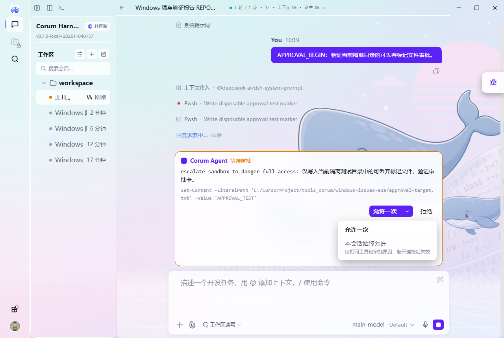
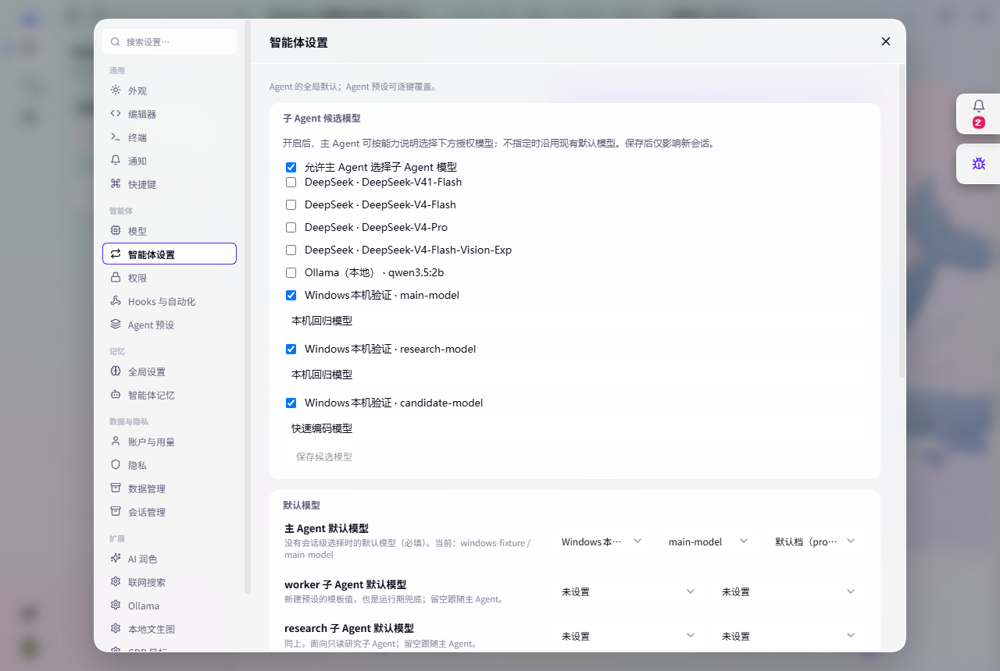
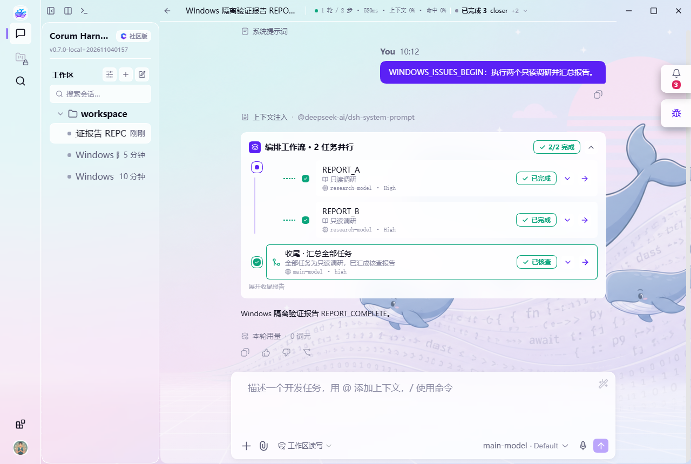

# 审批、模型与会话问题修复验证

## 范围与基线

基于 `main@07f7a5d7`，修复 #181、#171、#172、#167、#165、#166、#157、#148、#149、#125。#121、#122、#124 在基线已有实现，本次核查并补充回归，不重复修改对应功能。按用户要求排除 Linux 专属 #151。

复用已有 PR #154（#148）、#156（#149）、#176（#157）的源码与测试，适配最新 main 后整体验证；不包含 #153 的默认会话目录功能或 #179 的升级分支改动。

## 修复行为

- 审批：Remote callback 保留 this，正确解析会话；无法识别归属返回 unavailable。本会话始终允许仅匹配相同工具与审批原因，断连、删除会话或卸载后清理。移除无实现的自动占位。审批卡放入会话流，新卡和展开菜单避开实际 composer。
- 模型：新建、复用与冷恢复使用一致路由，保留 reasoningEffort；seeded fork 会话通过 Session.fromRestore 恢复完整历史。已保存供应商可重新获取并多选追加模型，保留完整旧配置。research 使用其角色配置。
- 候选模型：多选、能力说明、设置入口、list_subagent_models、allowlist、预检、实际委派及系统提示贯通，默认关闭时保留旧行为。
- 失败处理：支持临时指定、永久更改、重试、取消；不同模型的并发决定互不混用，显式选择不被旧覆盖误判为陈旧，取消不清除既有永久选择。
- 文档：前台、后台、continuable 和编排报告保存在父会话实际持久目录；每个 run 独立保存。定位或写盘失败保留原正文，不用不存在的文件替代唯一结果。
- 界面：修正 TODO 展开、收起箭头方向。
- 提交门禁：登记新增 ./model-selection-settings 入口，并用 path.basename 修正 verify-plugin-spec.mjs 的 Windows 目录名判断。

## 提交前重新验证

环境为 Windows、Node.js v24.15.0。以下为当前分支在提交前重新运行的结果；不将上一轮历史记录冒称为本轮重跑。

| 完整测试包 | 通过 | 跳过 | 失败 |
| --- | ---: | ---: | ---: |
| corum-tool-subagent | 469 | 0 | 0 |
| corum-agent | 437 | 0 | 0 |
| corum-orchestration | 147 | 0 | 0 |
| corum-api-remotes | 22 | 0 | 0 |
| corum-ui-conversation | 30 | 0 | 0 |
| corum-ui-settings-models | 76 | 0 | 0 |
| corum-ui-model-ask | 44 | 0 | 0 |
| corum-ide-ui | 38 | 0 | 0 |
| corum-session-archive | 18 | 0 | 0 |
| corum-ide-sidebar-ui | 15 | 0 | 0 |
| desktop | 141 | 1 | 0 |
| 合计 | 1437 | 1 | 0 |

测试使用各包真实 vitest run，desktop 使用 node --test tests/*.test.mjs。desktop 跳过项为既有 Windows symlink 条件跳过。

首次以三个包并行复跑时，isolation-guard.spec.ts 的既有 Git worktree 自动提交用例超过 5000ms（5231ms），该轮为 468 passed / 1 failed。未修改代码或提高超时阈值；停止其他测试后单独重跑 corum-tool-subagent 完整包，469 passed / 0 failed。上表为每个包的最终结果，并非全仓单次运行结果。

- 受影响的 10 个源码包执行 tsc -b --force，通过；corum-tool-subagent 的源码与 spec 在实现阶段均已强制检查。
- node scripts/build-all.mjs：55 个包、30 个 client 插件全部就绪；UI build 包含 TypeScript、tsdown、inline-css。
- node scripts/verify-plugin-spec.mjs --strict：51 个插件包，error 0 / warn 0。
- node scripts/verify-plugin-guide.mjs：通过，包含 k1/k2 脚手架冒烟。
- git diff --check：通过。

可用仓库标准命令复跑相关包，例如：

```powershell
pnpm --filter @corum/corum-tool-subagent test
pnpm --filter @corum/corum-agent test
pnpm --filter @corum/corum-ui-conversation test
pnpm --filter @corum/corum-ui-settings-models test
pnpm --filter corum-desktop test
node scripts/build-all.mjs
node scripts/verify-plugin-spec.mjs --strict
node scripts/verify-plugin-guide.mjs
```

本地 pnpm 未生成 tsc 命令入口，验证时使用工作树外的临时入口调用同一份 TypeScript；没有更改依赖或 lockfile。保留既有 tsdown external 弃用提示与上游缺失 sourcemap 警告。

## Windows 实机验证

以下实机取证在实现阶段完成，本次提交前未重复启动桌面。使用独立 CORUM_HOME、Electron 用户目录、本机 OpenAI-compatible fixture 和合成凭据；没有调用收费模型或上传用户真实数据。

### 审批送达与可见性

真实 pwsh 先被 workspace 沙箱拒绝，再请求提权。审批显示在会话流中，输入框保留。像素断言验证面板和展开菜单的可见边框位于 composer 上方；本会话始终允许按钮可用。选择后只写入本任务可丢弃的标记文件，内容为 APPROVAL_TEST。

精确授权、多会话隔离、断连清理由行为回归覆盖。重复授权 fixture 初版复用了 tool-call ID，引发合成会话轨迹重复 start；该轮不作为通过证据，fixture 已改为唯一 ID。



### 候选模型与能力说明

settings/describe 实际注册带 description 的候选 namespace。启用候选后，新会话暴露 list_subagent_models；设置界面正确显示已保存候选和能力说明。



### 编排路由与父会话报告

真实 orchestrate 发起两个 research 任务。HTTP body.model 两次均为 research-model；父会话和 closer 为 main-model。结果包含两项 ok=true、closer.reportWritten=true；每个子任务正文、每个结束 run 和编排汇总均实际写入父会话 artifact 子目录，并可冷读。关键场景首次取证无 renderer error。



## 复审与边界

分组和全分支独立复审发现的保存失败吞结果、seeded 冷恢复、多模型并发决定、陈旧判断和提示词矛盾均先补失败回归再修复。

- 未做 macOS/Linux 实机、发行安装包或真实模型供应商验证；远端 CI 结果以 PR checks 为准。
- #121/#122/#124 主要通过 Windows host、真实 React 渲染回归和代码链路核查，未逐个重复桌面点击验收。
- 候选配置影响新会话，既有会话保留授权快照；永久改为主模型保存当次具体路由。
- generic 非 continuable 后台 one-shot 运行失败保留通知主 Agent 重派的既有行为；Corum 默认 continuable 支持确认后的指定模型续跑。
- 报告随本地会话目录保存和删除；本次未扩展 ZIP 导入、导出格式。
- 没有重复运行全仓所有包测试；没有本地官方 dsh checkout，因此未运行 fork-drift。
